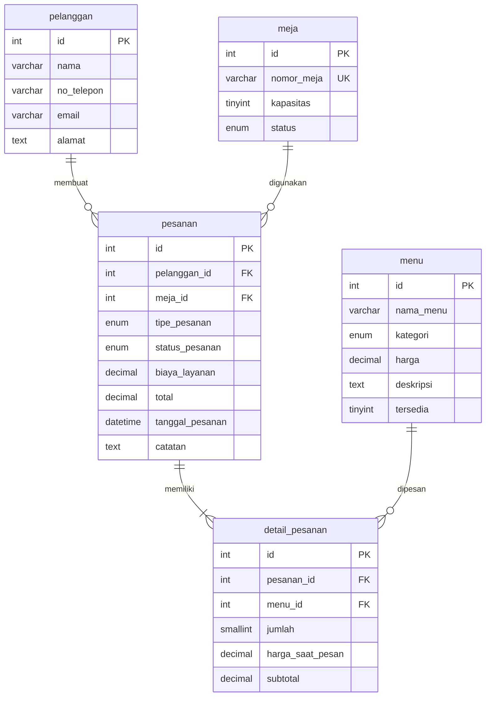

# Sistem Pemesanan Restoran (RestOrder)

Aplikasi web PHP untuk mengelola pemesanan restoran — mencakup reservasi meja, data pelanggan, input pesanan (dine-in & take-away), serta laporan pemesanan dengan export PDF.

Dibuat sebagai tugas praktik untuk Uji Sertifikasi Kompetensi **Programmer** (skema BNSP).

## Fitur Utama

1. **Dashboard** — ringkasan data (meja tersedia, pesanan hari ini, pendapatan)
2. **Kelola Meja** — CRUD meja, reservasi, lihat status (tersedia/terisi/dipesan)
3. **Data Pelanggan** — CRUD data pelanggan
4. **Daftar Menu** — CRUD menu makanan, minuman, dessert
5. **Pesanan** — buat pesanan (dine-in dengan biaya layanan 10% vs take-away tanpa biaya layanan), lihat detail, selesaikan/batalkan
6. **Laporan** — filter pesanan berdasarkan tanggal & pelanggan, export ke PDF

## Teknologi & Library

| Komponen | Keterangan |
|----------|-----------|
| PHP 8.1+ | Bahasa utama (vanilla PHP, tanpa framework) |
| MySQL/MariaDB | Database relasional |
| PDO | Akses database (prepared statement) |
| Composer | Dependency manager & PSR-4 autoloader |
| **Dompdf v3.1** | Library untuk export HTML ke PDF (Lisensi: LGPL) |
| vlucas/phpdotenv | Membaca konfigurasi dari file `.env` |
| PHPUnit 10.5 | Unit testing |
| Bootstrap 5.3 (CDN) | Framework CSS untuk tampilan UI (reuse komponen UI) |
| Bootstrap Icons (CDN) | Ikon untuk navigasi dan tombol |

### Mengapa Dompdf?

Dompdf dipilih sebagai library pre-existing untuk mendemonstrasikan **reuse** karena:
- Sudah teruji dan stabil sebagai PDF generator PHP
- Cukup menerima string HTML → otomatis dikonversi ke PDF
- Jauh lebih efisien dibanding menulis PDF generator sendiri dari nol
- **Lisensi LGPL** — boleh digunakan dalam project apapun tanpa mengharuskan project kita open-source

## Struktur Project

```
restorder/
├── composer.json          # Konfigurasi Composer (PSR-4 autoload + dependency)
├── phpunit.xml            # Konfigurasi PHPUnit
├── .env.example           # Template environment variable
├── .gitignore
│
├── config/
│   ├── app.php            # Konfigurasi aplikasi (debug mode, error handling)
│   └── database.php       # Koneksi PDO ke MySQL (baca dari .env)
│
├── database/
│   └── schema.sql         # Schema DDL + seed data
│
├── public/                # Document root (entry point)
│   ├── index.php          # Front controller (routing)
│   └── assets/            # CSS, JS statis
│
├── src/
│   ├── Models/            # Kelas OOP (encapsulation, inheritance, polymorphism)
│   │   ├── Pengguna.php         # Abstract class (parent)
│   │   ├── Pelanggan.php        # Extends Pengguna
│   │   ├── Admin.php            # Extends Pengguna
│   │   ├── Meja.php
│   │   ├── Menu.php
│   │   ├── DetailPesanan.php
│   │   ├── Pesanan.php          # Abstract class (polymorphism)
│   │   ├── PesananDineIn.php    # Extends Pesanan (+biaya layanan)
│   │   └── PesananTakeAway.php  # Extends Pesanan (tanpa biaya layanan)
│   │
│   ├── Repositories/      # DAO — akses database (CRUD via PDO)
│   │   ├── MejaRepository.php
│   │   ├── PelangganRepository.php
│   │   ├── MenuRepository.php
│   │   └── PesananRepository.php
│   │
│   ├── Services/          # Logika bisnis (validasi, kalkulasi)
│   │   ├── ValidasiService.php
│   │   ├── PesananService.php
│   │   └── LaporanService.php
│   │
│   └── Controllers/       # Request handler
│       ├── BaseController.php
│       ├── DashboardController.php
│       ├── MejaController.php
│       ├── PelangganController.php
│       ├── MenuController.php
│       ├── PesananController.php
│       └── LaporanController.php
│
├── views/                 # Template PHP (tampilan HTML)
│   ├── layouts/main.php   # Layout utama (sidebar + content)
│   ├── dashboard/
│   ├── meja/
│   ├── pelanggan/
│   ├── menu/
│   ├── pesanan/
│   └── laporan/
│
├── tests/                 # Unit test PHPUnit
│   ├── PesananTest.php
│   └── ValidasiServiceTest.php
│
└── logs/                  # Log file (error/debug)
```

## ERD (Entity Relationship Diagram)



## Cara Setup & Menjalankan

### 1. Prasyarat
- PHP 8.1 atau lebih baru
- MySQL/MariaDB
- Composer

### 2. Install Dependency
```bash
composer install
```

### 3. Konfigurasi Database
```bash
# Salin template environment
cp .env.example .env

# Edit .env, sesuaikan kredensial database Anda:
# DB_HOST=localhost
# DB_DATABASE=restorder
# DB_USERNAME=root
# DB_PASSWORD=
```

### 4. Import Schema Database
Buka phpMyAdmin atau MySQL CLI, lalu jalankan:
```sql
source database/schema.sql
```
Atau import file `database/schema.sql` via phpMyAdmin.

### 5. Jalankan Server Development
```bash
php -S localhost:8000 -t public
```
Buka browser di `http://localhost:8000`.

### 6. Menjalankan Unit Test
```bash
vendor/bin/phpunit
```

## Konsep OOP yang Diimplementasikan

| Konsep | Implementasi | File |
|--------|-------------|------|
| **Encapsulation** | Semua property private/protected + getter/setter | Semua model di `src/Models/` |
| **Inheritance** | `Pengguna` → `Pelanggan`, `Admin` | `Pengguna.php`, `Pelanggan.php`, `Admin.php` |
| **Polymorphism** | `Pesanan::hitungTotal()` dioverride berbeda | `PesananDineIn.php` vs `PesananTakeAway.php` |
| **Emulasi Overloading** | Optional parameter + `func_get_args()` | `Pengguna.php` constructor, `Pesanan.php` constructor |

## Debugging

- **Development**: set `APP_DEBUG=true` di `.env` → error PHP ditampilkan di browser
- **Production**: set `APP_DEBUG=false` → error disembunyikan, dicatat ke `logs/app.log`
- Untuk melihat log: `tail -f logs/app.log`
